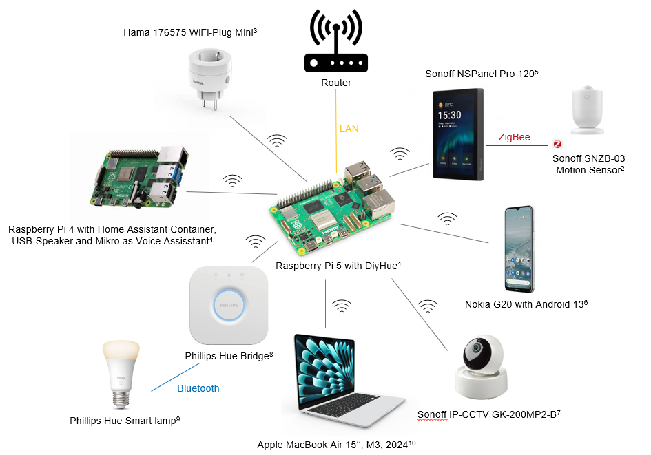

# Smart-Home-Sandbox Data Analysis

This repository contains the code and data relevant to the smart home sandbox.

The goal was to capture benign network traffic from real smart home devices and use it to create traceable datasets for future ML-based intrusion detection.

## Architecture



## Setup

The sandbox consisted of real smart-home devices. The Raspberry Pi 5 served as the central network node and collected the devices' traffic.

Genutzt wurden unter anderem:

* Raspberry Pi 5 with DiyHue
* Raspberry Pi 4 with Home Assistant Container and Voice Assistant
* Sonoff NSPanel Pro 120
* Sonoff Motion Sensor SNZB 03
* Sonoff IP-CCTV
* Hama WiFi-Plug Mini
* Philips Hue Bridge
* Philips Hue Smart Lamp
* Nokia G20
* Apple MacBook Air

Home Assistant was used for device integration and automations

## Dataset Structure

```text
sandbox
├── main.py
├── classes
│   ├── flow_tracker.py
│   └── network_capture.py
└── dataset
    ├── network_traffic.csv
    ├── login_attempts.csv
    ├── commands.csv
    ├── binary_information.csv
    ├── network_binary_connection.csv
    └── data_scenarios
        └── einzelne CSV-Dateien pro Szenario

HomeAssistant_automations
├── turn_off_socket
├── turn_on_socket
├── scenario_hue_lamp
└── question_time

baseline_model
├── baseline_model.ipynb
├── results
└── data
    ├── benign
	    ├── network_traffic.csv
    	├── login_attempts.csv
    	├── commands.csv
    	├── binary_information.csv
    	├── network_binary_connection.csv
    	└── data_scenarios
    └── malicious
	    ├── network_traffic.csv
    	├── login_attempts.csv
    	├── commands.csv
    	├── binary_information.csv
    	├── network_binary_connection.csv
    	└── data_scenarios
```

## `Sandbox`

Source code for network structure.

`network_capture.py` starts the live capture using `scapy`. Each packet is passed to the `FlowTracker`. When the capture is stopped, CSV files are written.

`flow_tracker.py` processes the packets. The file creates flows, counts packets and bytes, and collects basic information about network traffic and login attempts.

Important outputs are:

* `network_traffic.csv`
* `login_attempts.csv`
* Flow-CSV

## Starting Sandbox Script

```bash
cd sandbox
sudo python3 main.py -i wlan0 -o data_v1/capture.csv
```

`-i wlan0` passed network interface to capture network traffic
`-o data_v1/capture.csv` output file.

Capturing continues until it is stopped with `Ctrl+C`. Afterward, the results are automatically saved. In addition to the CSV files for network traffic and login attempts, an additional flow file is also created.

```text
data_v1/capture.csv
data_v1/capture_network_traffic.csv
data_v1/capture_login_attempts.csv
```

```bash
sudo python3 main.py -i wlan0 -o data_v1/capture.csv -c 10000
```
`-c 10000` captures a maximum of 10000 packets

```bash
sudo python3 main.py -i wlan0 -o data_v1/capture.csv -d 3600
```
`-d 3600` captures for a maximum of 1h

## `network_capture.py`

This file starts capturing on a network interface, such as `wlan0`.

Essentially, it does three things:

* Capture packets in real time using Scapy
* Pass the packets to `flow_tracker.py`
* Save the results as a CSV file

## `flow_tracker.py`

This file analyzes the packets.

It identifies communication relationships between devices and destinations. Identical connections are grouped using `count`. This results in the file `network_traffic.csv`.

It can also detect simple login attempts. Passwords are not stored in plain text but are hashed.

The CSV structures created are:

```text
network_traffic.csv
src_ip,count,url,threat,tags
```

```text
login_attempts.csv
username,password,src_ip,dst_ip,protocol,count,successful
```

## `HomeAssistant_automations`

This folder contains the automations used for the scenarios.

* `turn_on_socket`
* `turn_off_socket`
* `scenario_hue_lamp`
* `question_time`


## `Baseline Model`

The `proof_of_concept.ipynb` notebook is a simple test to determine whether the generated data can, in principle, be used for ML-based anomaly detection.

It loads benign and malicious data, preprocesses features, trains a simple autoencoder, and saves the results in the `results` folder.

Starting:

```bash
cd baseline_model
jupyter notebook baseline_model.ipynb
```
Data are stored in the following directories:

```text
baseline_model/data/benign
baseline_model/data/malicious
```

The baseline model is not a comprehensive model evaluation. It merely demonstrates whether the data can, in principle, be processed further.

## Dataset and Results

The repository also contains the CSV files generated from the sandbox:

* `network_traffic.csv`
* `login_attempts.csv`
* `commands.csv`
* `binary_information.csv`
* `network_binary_connection.csv`
* einzelne Szenario-Dateien unter `data_scenarios`