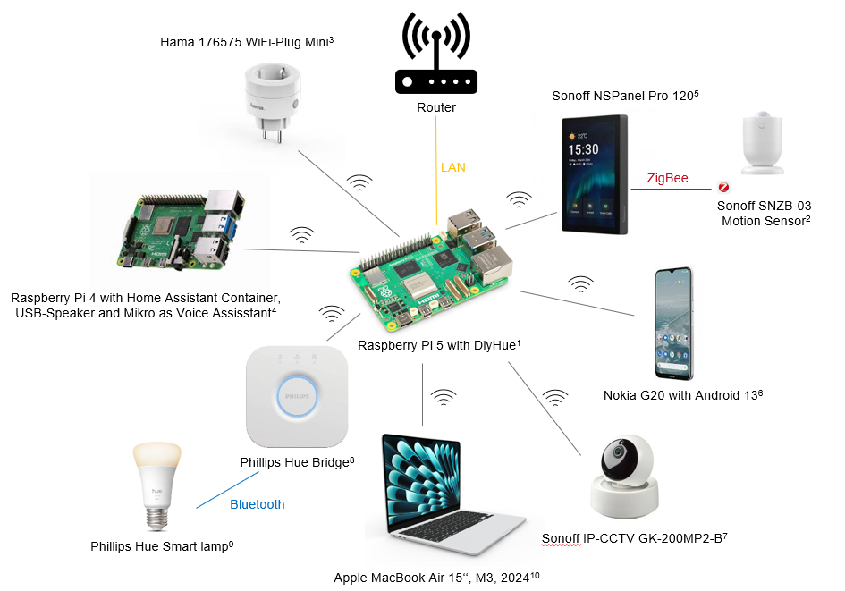

# Smart-Home-Sandbox Data Analysis

Dieses Repository enthält den Code und die Daten, die für meine Bachelorarbeit zur Smart-Home-Sandbox relevant sind.

Ziel war es, gutartigen Netzwerkverkehr von echten Smart-Home-Geräten zu erfassen und daraus nachvollziehbare Datensätze für spätere ML-basierte Intrusion Detection zu erstellen.

## Architektur



## Setup

Die Sandbox bestand aus realen Smart-Home-Geräten. Der Raspberry Pi 5 war der zentrale Netzwerkknoten und hat den Traffic der Geräte gesammelt.

Genutzt wurden unter anderem:

* Raspberry Pi 5 mit DiyHue
* Raspberry Pi 4 mit Home Assistant Container und Voice Assistant
* Sonoff NSPanel Pro
* Sonoff Motion Sensor
* Sonoff IP-Kamera
* Hama WiFi-Plug Mini
* Philips Hue Bridge
* Philips Hue Smart Lamp
* Nokia G20
* Apple MacBook Air

Home Assistant wurde für Geräteintegration und für Automationen genutzt.

## Ordnerstruktur

```text
sandbox
├── main.py
├── classes
│   ├── flow_tracker.py
│   └── network_capture.py
└── dataset
    ├── network_traffic.csv
    ├── login_attempts.csv
    ├── commands.csv
    ├── binary_information.csv
    ├── network_binary_connection.csv
    └── data_scenarios
        └── einzelne CSV-Dateien pro Szenario

HomeAssistant_automations
├── turn_off_socket
├── turn_on_socket
├── scenario_hue_lamp
└── question_time

proof_of_concept
├── proof_of_concept.ipynb
├── results
└── data
    ├── benign
	    ├── network_traffic.csv
    	├── login_attempts.csv
    	├── commands.csv
    	├── binary_information.csv
    	├── network_binary_connection.csv
    	└── data_scenarios
    └── malicious
	    ├── network_traffic.csv
    	├── login_attempts.csv
    	├── commands.csv
    	├── binary_information.csv
    	├── network_binary_connection.csv
    	└── data_scenarios
```

## `sandbox`

Hier liegt der Code für die Netzwerkerfassung.

`network_capture.py` startet den Live-Mitschnitt mit Scapy. Jedes Paket wird an den `FlowTracker` weitergegeben. Beim Stoppen der Aufnahme werden CSV-Dateien geschrieben.

`flow_tracker.py` verarbeitet die Pakete. Die Datei bildet Flows, zählt Pakete und Bytes und sammelt einfache Informationen zu Netzwerkverkehr und Login-Versuchen.

Wichtige Ausgaben sind:

* `network_traffic.csv`
* `login_attempts.csv`
* Flow-CSV

## Sandbox-Script starten

```bash
cd sandbox
sudo python3 main.py -i wlan0 -o data_v1/capture.csv
```

`-i wlan0` steht für das Netzwerkinterface, auf dem mitgeschnitten wird
`-o data_v1/capture.csv` legt fest, wohin die Dateien gespeichert werden.

Die Aufnahme läuft, bis sie mit `Ctrl+C` beendet wird. Danach werden die Ergebnisse automatisch gespeichert. Neben der CSV-Dateien für Netzwerkverkehr und Login-Versuche entsteht auch eine zusätzliche Flow-Datei.

```text
data_v1/capture.csv
data_v1/capture_network_traffic.csv
data_v1/capture_login_attempts.csv
```

Optional kann die Aufnahme begrenzt werden.

```bash
sudo python3 main.py -i wlan0 -o data_v1/capture.csv -c 10000
```
nimmt maximal 10.000 Pakete auf.

```bash
sudo python3 main.py -i wlan0 -o data_v1/capture.csv -d 3600
```
nimmt eine Stunde lang auf.

## `network_capture.py`

Diese Datei startet die Aufnahme auf einem Netzwerkinterface, zum Beispiel `wlan0`.

Sie macht im Kern drei Dinge:

* Pakete live mit Scapy mitschneiden
* Pakete an `flow_tracker.py` weitergeben
* Ergebnisse als CSV speichern

Die Aufnahme wird mit `Ctrl+C` beendet. Danach werden die finalen Dateien geschrieben.

## `flow_tracker.py`

Diese Datei wertet die Pakete aus.

Sie erkennt Kommunikationsbeziehungen zwischen Geräten und Zielen. Gleiche Verbindungen werden über `count` zusammengefasst. Daraus entsteht die Datei `network_traffic.csv`.

Außerdem können einfache Login-Versuche erkannt werden. Passwörter werden nicht im Klartext gespeichert, sondern gehasht.

Die erstellten CSV-Strukturen sind:

```text
network_traffic.csv
src_ip,count,url,threat,tags
```

```text
login_attempts.csv
username,password,src_ip,dst_ip,protocol,count,successful
```

## `HomeAssistant_automations`

Dieser Ordner enthält die Automationen, die für die Szenarien genutzt wurden.

* `turn_on_socket`
* `turn_off_socket`
* `scenario_hue_lamp`
* `question_time`


## `proof_of_concept`

Das Notebook `proof_of_concept.ipynb` ist ein einfacher Test, ob die erzeugten Daten grundsätzlich für ML-basierte Anomaly Detection nutzbar sind.

Es lädt benigne und malicious Daten, bereitet Features auf, trainiert einen einfachen Autoencoder und speichert die Ergebnisse im Ordner `results`.

Starten:

```bash
cd proof_of_concept
jupyter notebook proof_of_concept.ipynb
```
Die Daten liegen hier:

```text
proof_of_concept/data/benign
proof_of_concept/data/malicious
```

Der Proof of Concept ist keine vollständige Modellbewertung. Er zeigt nur, ob die Daten grundsätzlich weiterverarbeitet werden können.

## Datensätze und Ergebnisse

Im Repository liegen außerdem die erzeugten CSV-Dateien aus der Sandbox:

* `network_traffic.csv`
* `login_attempts.csv`
* `commands.csv`
* `binary_information.csv`
* `network_binary_connection.csv`
* einzelne Szenario-Dateien unter `data_scenarios`